<div align="center">

# 📷 Leonida Lens

**O estúdio de fotografia para quem fotografa a vida em Leonida (GTA VI, PS5).**
Suas capturas viram um acervo com ficha de campo, mapa, ensaios — e uma galeria online linda, no computador e no celular.

[**⬇️ Baixar o instalador (Windows)**](../../releases/latest) · [Guia passo a passo](#-passo-a-passo-do-zero-para-iniciantes) · [Perguntas frequentes](#-perguntas-frequentes)

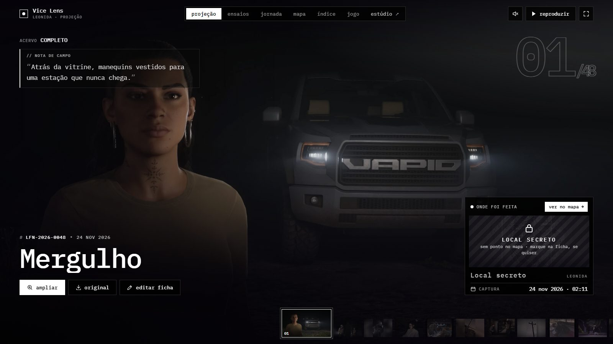

</div>

---

## 👋 Por que isso existe

Eu sou programador e passo tempo demais em duas coisas: **jogos** e **fotografia**. Quando o GTA VI chegou, fiz o que qualquer
pessoa com essas duas manias faria: comecei a fotografar Leonida como se fosse uma cidade de verdade — a calçada de Vice Beach
às 6 da manhã, um posto vazio em Kelly County sob chuva, gente esperando o ônibus em Hamlet.

O problema: as capturas do PS5 ficam espalhadas, sem contexto, e somem da nuvem da Sony em ~14 dias. Faltava um **lugar para
cuidar dessas fotos como um fotógrafo cuida de um arquivo**: com número de tombo, onde foi feita, que horas eram no jogo, o clima,
uma frase de campo. E faltava um jeito bonito de **mostrar** isso.

O **Leonida Lens** é esse lugar. Ele roda **no seu PC** (nada de contas, nada de servidor meu) e, se você quiser, publica uma
galeria **só de visualização** no seu próprio site gratuito.

---

## ✨ O que ele faz

<table>
<tr>
<td width="50%">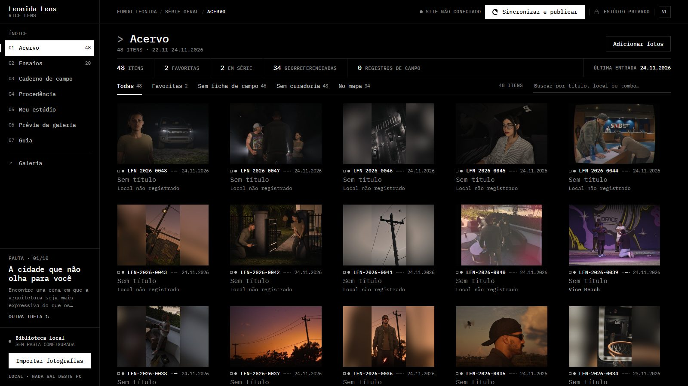<br><b>Acervo</b> — todas as capturas organizadas, com tombo, filtros e busca. As fotos chegam sozinhas da nuvem do PlayStation.</td>
<td width="50%">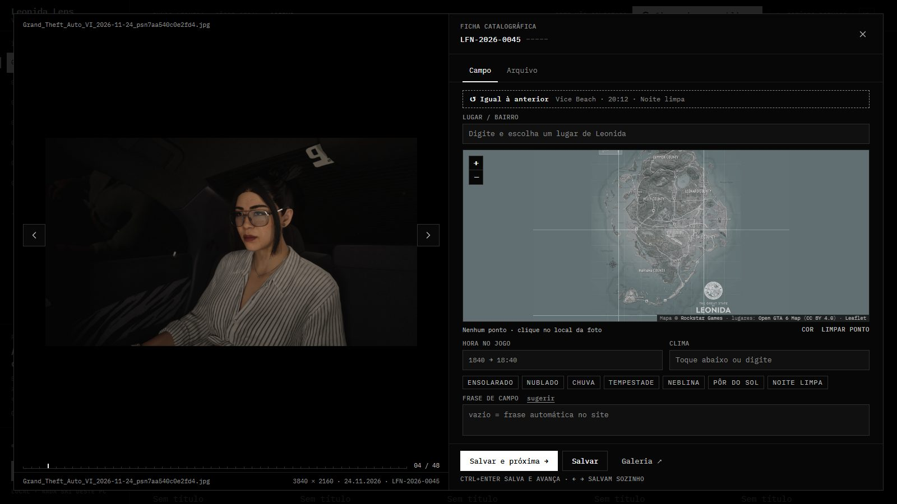<br><b>Ficha de campo</b> — local no mapa oficial de Leonida, hora no jogo, clima e frase. "Igual à anterior" e <kbd>Ctrl</kbd>+<kbd>Enter</kbd> para ir rápido.</td>
</tr>
<tr>
<td>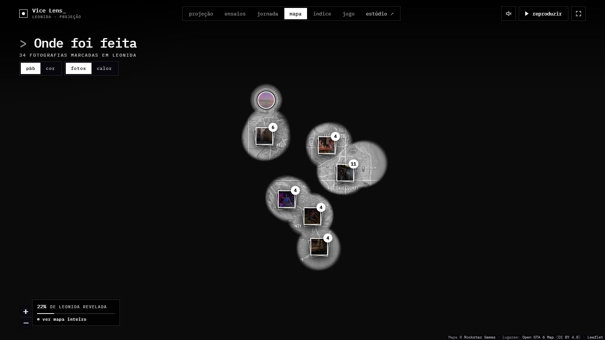<br><b>Mapa com névoa</b> — Leonida começa no escuro; cada foto revela a área em volta. "X% de Leonida revelada".</td>
<td>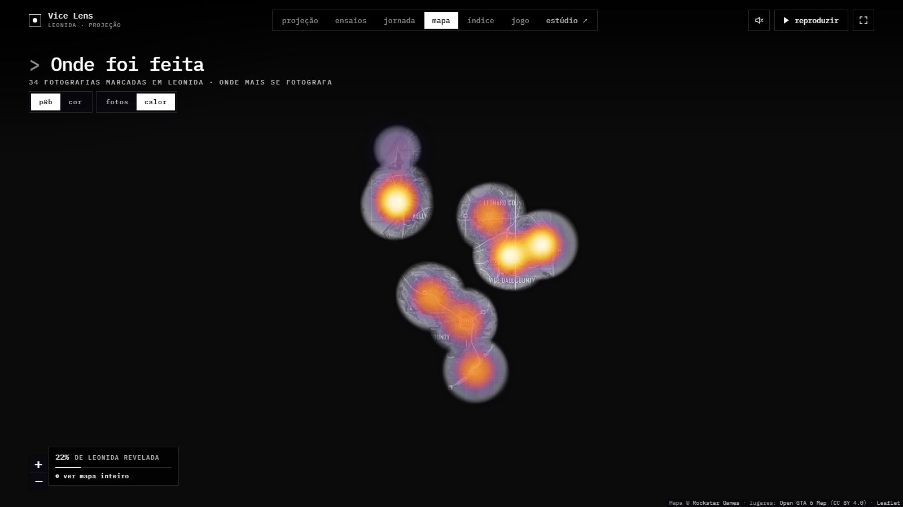<br><b>Mapa de calor</b> — onde você mais fotografa, em paleta térmica. Também dá para ver o <a href="docs/img/galeria-mapa-cor.jpg">mapa oficial em cores</a>.</td>
</tr>
<tr>
<td>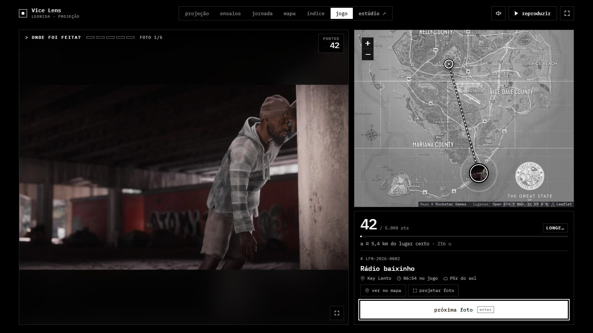<br><b>"Onde foi feita?"</b> — o visitante vê a foto e chuta no mapa onde ela foi tirada. 5 rodadas, até 25.000 pontos, recorde e compartilhar.</td>
<td>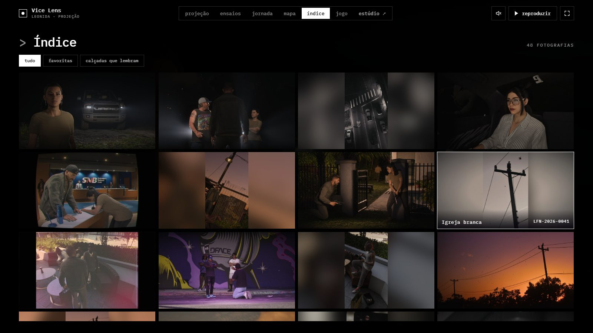<br><b>Galeria online</b> — projeção em tela cheia, ensaios, jornada mês a mês, índice e trilha sonora gerada ao vivo.</td>
</tr>
<tr>
<td>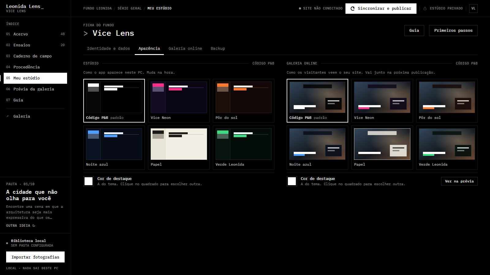<br><b>Temas</b> — 6 temas prontos (Código P&B, Vice Neon, Pôr do sol, Noite azul, Papel, Verde Leonida) + cor de destaque, separados para o Estúdio e a galeria.</td>
<td>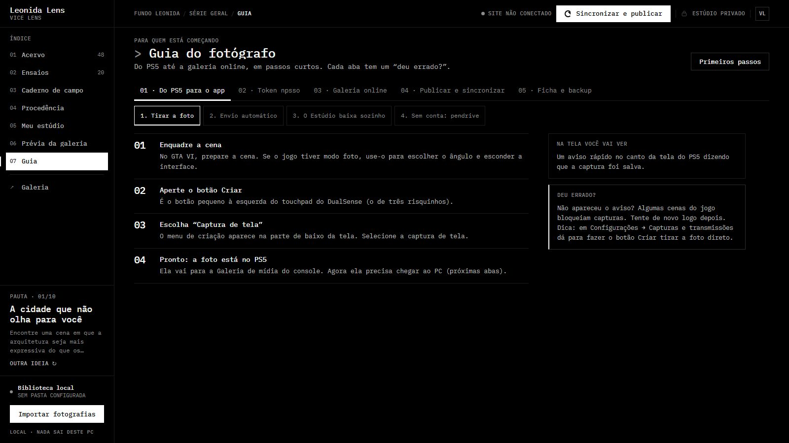<br><b>Guia do fotógrafo</b> — tudo explicado passo a passo dentro do app, com "deu errado?" em cada parte.</td>
</tr>
</table>

<div align="center">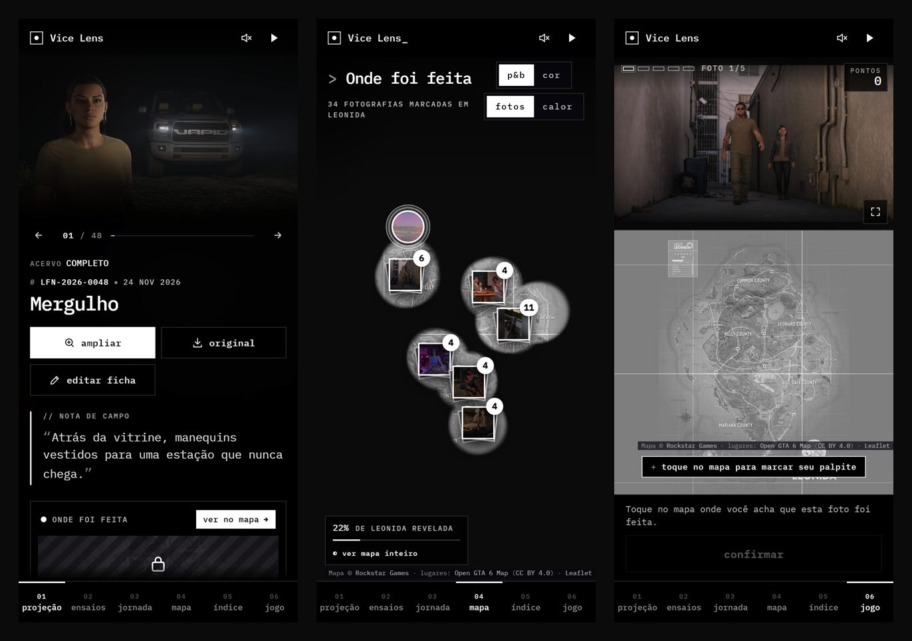<br><i>A galeria no celular: projeção, mapa com névoa e o jogo.</i></div>

---

## 🧭 Passo a passo do zero (para iniciantes)

> Leva uns 10 minutos. Você só precisa de um PC com **Windows 10/11**, seu **PS5** com GTA VI e o **PlayStation App** no celular.

### 1. Instalar

1. Baixe **`LeonidaLens-Setup-<versão>.exe`** na página de [**Releases**](../../releases/latest).
2. Dê dois cliques. Se o Windows mostrar **"O Windows protegeu o computador"**, clique em **Mais informações → Executar assim mesmo**
   (o aviso aparece porque o instalador não tem assinatura digital paga — é normal em projetos independentes).
3. Avance as telas. Não precisa de administrador nem de instalar mais nada: Python, Pillow e Node já vão dentro.
4. No fim, deixe marcado **"Abrir o Leonida Lens"**. O app abre **em tela cheia**, no assistente de primeiros passos.

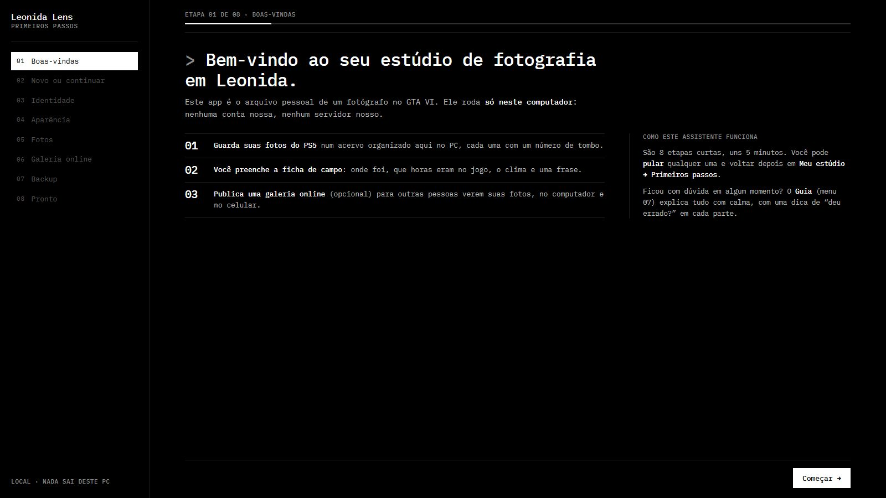

### 2. O assistente (8 telas curtas)

- **Novo estúdio** — é a sua primeira vez? Escolha esta.
- **Continuar meu estúdio** — já usa em outro PC? Aponte o backup (`.zip` ou a pasta de backup no OneDrive/Google Drive) e tudo
  volta: fotos, fichas, ensaios, tema e até o endereço da sua galeria. [Detalhes abaixo](#-levar-o-seu-estúdio-para-outro-pc).
- Depois: **nome do estúdio**, **assinatura**, **aparência**, **fotos**, **galeria online** e **backup**. Dá para pular qualquer
  etapa e voltar depois em **Meu estúdio → Primeiros passos**.

### 3. Do PS5 para o app

1. **No jogo**, monte a cena e aperte o botão **Criar** do DualSense (o pequeno à esquerda do touchpad) → **Captura de tela**.
2. **No PS5**, ative o envio automático: **Configurações → Capturas e transmissões → Capturas → envio automático** para o
   PlayStation App (o nome pode variar um pouco entre versões do sistema).
3. Tenha o **PlayStation App** no celular, logado **na mesma conta** do PS5.
4. Pronto: as capturas sobem para a nuvem da Sony (ficam lá **~14 dias**) e o Leonida Lens **baixa sozinho** a cada 15 minutos
   com o app aberto — ou na hora, no botão **Sincronizar e publicar**.

> **Sem conta, sem token?** Use pendrive: no PS5, **Galeria de mídia → Copiar para unidade USB**, e no app escolha a pasta
> (**Procedência → Pasta**) ou simplesmente **arraste** as fotos para a janela.

### 4. O token da Sony (npsso) — com calma e com segurança

O Leonida Lens lê suas capturas da nuvem usando um **token** (uma chave temporária da sua conta). **Ele nunca pede sua senha.**

1. No **navegador do PC**, entre no site oficial da Sony/PlayStation com sua conta PSN, normalmente.
   **A senha é digitada só no site da Sony.**
2. Na mesma janela, abra: **https://ca.account.sony.com/api/v1/ssocookie**
3. Vai aparecer algo assim: `{"npsso":"Ab12Cd34…"}`.
4. Copie **só o valor entre aspas** (64 caracteres, **sem** as aspas).
5. No app: cole no campo **Valor npsso** e clique **Conectar**.

> ⚠️ **NUNCA digite sua senha da PSN no Leonida Lens.** O app nunca pede senha. Se algo pedir, não é o app.
> ⚠️ **Não mande o token para ninguém e não poste print dele** — ele dá acesso à sua conta enquanto valer.
> 🔒 No Windows ele fica protegido pelo próprio sistema (DPAPI) e **nunca entra em backups**.
> ⏳ O token pode expirar com o tempo. Se a conexão cair, é só repetir estes passos.
> 🧪 Essa integração usa interfaces **não oficiais** da Sony e pode parar se a Sony mudar algo — o pendrive é o plano B.

### 5. Galeria online (Cloudflare) — grátis

A galeria é um site **só de visualização** (visitantes não fazem login, não comentam, não curtem). Ela fica hospedada na
**sua própria conta** gratuita da Cloudflare.

1. Em **Meu estúdio → Galeria online** (ou no assistente), clique **Conectar Cloudflare**.
2. O navegador abre: **crie a conta grátis** ou entre na sua.
3. Clique em **Allow / Permitir**. Volte ao app — pronto, está conectado.
4. O app cria o seu site (algo como `lfn-seu-estudio.pages.dev`) e publica sozinho.

> 💸 **Custo:** o plano gratuito do Cloudflare Pages **não pede cartão de crédito** e **não tem cobrança automática**. Se algum
> limite do plano grátis for atingido, a Cloudflare **não cobra** — ela só deixa de aceitar novos envios até o próximo ciclo.
> Nada é cobrado sem você escolher, por conta própria, um plano pago.
> 🔑 O app **não guarda senha da Cloudflare**: a autorização fica com o *wrangler*, a ferramenta oficial da própria Cloudflare.
> 👥 Cada pessoa usa a **própria conta** → cada galeria é separada, com endereço próprio.

### 6. Publicar e sincronizar

- **Sincronizar e publicar** (no topo, ou <kbd>Ctrl</kbd>+<kbd>S</kbd>): busca fotos novas (nuvem da Sony + pasta) e atualiza o site.
- O site também se atualiza **sozinho** quando algo público muda.
- **O que vai para o site:** fotos com **"Publicar na galeria online"** marcado na ficha e os ensaios publicados.
- **O que nunca vai:** o Estúdio, fichas não publicadas, tokens e backups.

### 7. Ficha de campo e backup

- Abra uma foto, preencha **local** (clique no mapa ou digite o lugar), **hora no jogo** (`1840` vira `18:40`), **clima** e
  **frase**. **Igual à anterior** copia local/hora/clima. <kbd>Ctrl</kbd>+<kbd>Enter</kbd> salva e vai para a próxima.
- Em **Meu estúdio → Backup**, escolha uma pasta do **OneDrive/Google Drive**: o app copia fotos e banco para lá a cada 30 minutos.

---

## 💻 Levar o seu estúdio para outro PC

1. No PC antigo: **Meu estúdio → Backup** com uma pasta sincronizada (OneDrive/Google Drive) **ou** **Baixar backup (.zip)**.
2. No PC novo: instale e, no assistente, escolha **Continuar meu estúdio** → aponte a pasta ou o `.zip`.
3. Volta tudo: fotos, fichas, ensaios, tema e o mesmo projeto da galeria (**mesmo endereço**).
4. Falta só: **Conectar Cloudflare** (mesma conta) e **colar o token da Sony de novo** — por segurança ele nunca viaja no backup.

---

## ❓ Perguntas frequentes

**Meus dados vão para algum servidor?** Não. Tudo fica em `LeonidaFieldNotes` na sua pasta de usuário. Só as fotos que você marca
como públicas vão para o **seu** site na Cloudflare.

**Desinstalar apaga minhas fotos?** Não. O desinstalador remove só o programa; a pasta de dados **nunca** é apagada.

**Funciona no Mac/Linux?** O instalador é só para Windows. Em Mac/Linux dá para rodar a partir do código (veja abaixo).

**O mapa é oficial?** Sim: o app baixa o pôster **"Leonida Map"** direto do site da Rockstar na primeira execução (ele não vem
no repositório nem no instalador). Sem internet, usa um mapa de fãs até conseguir baixar.

**Por que o token e não a senha?** Porque a senha só deve ser digitada no site da Sony. O token é uma chave temporária que dá
para revogar saindo da conta no site da Sony.

---

## 🛠️ Para desenvolvedores

```bash
python app.py                    # Estúdio (dados reais em ~/LeonidaFieldNotes)
python tools/sandbox.py          # Estúdio com uma CÓPIA da biblioteca (porta 8799) — use para testar
python tools/run_tests.py        # testes + checagem de sintaxe JS
python tools/build_installer.py  # gera dist/LeonidaLens-Setup-<versão>.exe
node tools/browser.mjs shot http://127.0.0.1:8799/galeria/#/mapa mapa --mobile   # capturas em Chrome headless
```

- **Estúdio:** servidor HTTP da biblioteca padrão do Python + SQLite + JS puro (`web/`). Pillow é opcional.
- **Galeria:** site estático (`web/galeria/`) publicado com `wrangler` no Cloudflare Pages.
- Bibliotecas de terceiros ficam copiadas em `web/vendor/` com a licença ao lado (nada de CDN em produção).
- Requisitos para rodar do código: Python 3.12+ (`pip install -r requirements.txt`), Node.js (só para publicar) e Chrome ou Edge.

---

## 🙏 Créditos

- Mapa oficial **"Leonida Map"** © Rockstar Games — baixado do [site oficial](https://www.rockstargames.com/VI/media), não redistribuído aqui.
- Nomes e coordenadas de lugares: [Open GTA 6 Map](https://github.com/fbritoferreira/gta6) (CC BY 4.0).
- [Leaflet](https://leafletjs.com), [Leaflet.markercluster](https://github.com/Leaflet/Leaflet.markercluster), [Leaflet.heat](https://github.com/Leaflet/Leaflet.heat),
  [PhotoSwipe](https://photoswipe.com) e o [plugin de legenda dinâmica](https://github.com/dimsemenov/photoswipe-dynamic-caption-plugin) — licenças em `web/vendor/`.
- Fontes IBM Plex Mono, Inter, Barlow Condensed e Instrument Serif (SIL OFL).

> **Projeto de fã, sem afiliação com a Rockstar Games, Take-Two ou Sony.** GTA, Grand Theft Auto e PlayStation são marcas de
> seus respectivos donos. As capturas mostradas aqui são do meu próprio jogo.

Feito com 🎮 + 📷 por [@void3333](https://github.com/void3333). Licença do código: [MIT](LICENSE).
